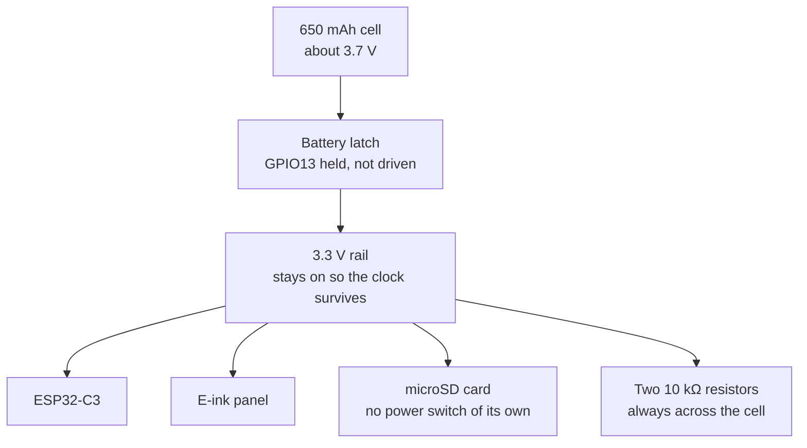
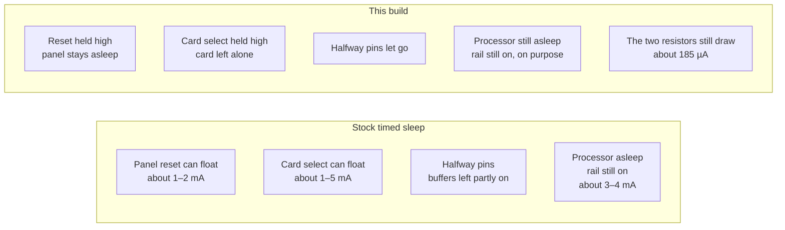
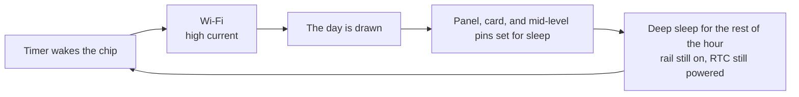

# Daily calendar firmware for the Xteink X4

This is [TRMNL firmware 1.8.17](https://github.com/usetrmnl/trmnl-firmware/releases/tag/v1.8.17) for the Xteink X4, with two changes.

The sleep current between hourly updates is lower. That part is the same change as [x4-longer-sleep](https://github.com/eulestadt/x4-longer-sleep), and the notes below explain it.

The X4 build also uses the daily calendar website when no server address has been saved:

`https://x4-daily-calendar-production.up.railway.app`

After Wi-Fi, the reader calls that website by itself. You do not open Advanced settings, and you do not type a server address. The website gives the reader a short code. Sign in with the Google account that owns the calendar, and press the button for that same code. One website can serve many readers. Each reader stays tied to the Google account that claimed its code.

If a later wake cannot join Wi-Fi, the picture already on the screen stays. The reader tries again later. Before any day or setup code has been drawn, a failed connection still shows the connection message.

Leave the Erase box empty when you flash. Empty keeps the Wi-Fi network and any server address already saved on the reader. A reader that already reaches its server keeps doing that. This build uses the calendar website only when the reader has no saved server address.

Advanced settings are still on the Wi-Fi page for a different server, a fixed IP address, or a reset. Leave the server field empty unless you run your own server.

The original project is GPL-3. This copy keeps that license. Sleep code is in `src/x4_sleep.cpp`. The calendar address is the `API_BASE_URL` flag on the `xteink_x4` build.

## **Power consumption**

A bit of background first. The current graph in the original TRMNL notes shows the sleep current this board does not reach, and why.

The ESP32-C3 is designed for low sleep current. In deep sleep it powers down main memory and can draw a few microamps. On a TRMNL OG, the practical number is higher than that minimum, because the device still has to detect a button press. Keeping one GPIO active for that button draws about 100 µA. The capture below is that deep sleep. Current stays around 100 µA, and the window readout reports average, maximum, duration, and charge.


100 µA is a low current. The original notes divide a 2500 mAh battery by 0.1 mA and get about 25,000 hours, then note that a device which only sleeps is not useful. The second picture is one real update. The chip wakes, Wi-Fi starts, and for several seconds the current is in the tens or hundreds of milliamps. Then the e-paper panel runs its update sequence, which switches often and draws much less than Wi-Fi. They measured one update at 0.67 coulomb, which is 0.186 mAh. Most of that charge is Wi-Fi.


Each hour has a short high-current interval and a long low-current interval. The interval that uses more charge per day is the one that discharges the cell.

The X4 uses the same kind of chip, with a different power circuit.

To wake on a timer, the RTC has to stay powered. On this board the RTC does not have a separate supply. The battery connects through a latch, a MOSFET, and GPIO13 holds that latch on. With the pin held, the 3.3 V rail stays powered, the RTC stays powered, and the reader can wake an hour later. If the pin is released, the rail turns off and the RTC loses power. After that, only the power button or USB can turn the reader on. This firmware keeps the hourly wake, so GPIO13 stays held and the rail stays on.



With that rail on, every load connected to it can draw current. Stock 1.8.17 put the processor into deep sleep and held GPIO13, and then stopped. The other loads were left active.

The e-ink controller is the first. It stays in sleep only while reset is high. If reset floats, the controller leaves sleep and draws about 1 to 2 mA, about a thousand times the 100 µA in the picture above. The firmware already sends the panel sleep command before the chip sleeps. It did not hold reset afterward. This build holds reset high. It does not send the sleep command a second time, because that command starts with a reset pulse and would wake the controller again.

The microSD card is the second. It is powered from the rail, and the board has no switch for it. TRMNL never mounts the card. A card left with chip-select floating can stay selected and draw 1 to 5 mA for the rest of the hour. Before sleep this build clocks the card's idle commands if the card responds, then holds chip-select high so the card is deselected.

The third load is the pins that sit at a mid-level voltage. GPIO0, the battery-sense pin, is between two 10 kΩ resistors, so its voltage is about half the cell voltage. GPIO20, USB detect, sits near 1 V. A digital input at that voltage does not read as a solid 0 or 1. The input buffer stays in its linear region and can draw milliamps. This build disables those input buffers, turns the pulls off, and leaves the pins floating. The button-ladder pins are handled the same way. GPIO13 is not in that list. Releasing it would turn the latch off.



The arithmetic below follows the original notes. Each figure is labeled as either a number from the 1.8.17 source or an estimate.

The 1.8.17 source describes X4 timed sleep as about 3 to 4 mA. Use 3.5 mA, the middle of that range, and assume the reader only sleeps.

3.5 mA × 24 hours = 84 mAh per day

650 / 84 ≈ 8 days

That result includes only the 3.5 mA. It matches the 25,000-hour figure in the original notes in one way: it is valid only if nothing else draws current, and only if the cell delivers its full rated capacity. 3.5 mA is about 35 times 100 µA, and this cell is 650 mAh rather than 2500 mAh, so the result is already much shorter than the OG graph.

On many boards the current was higher than 3.5 mA, because the panel and the card were still active. A floating reset adds about 1 to 2 mA. A card that was not sent the idle command can add 1 to 5 mA. Together with the 3 to 4 mA, the total can be about 8 mA.

8 mA × 24 hours = 192 mAh per day

650 / 192 ≈ 3 days

Then add the updates. This calendar wakes once an hour, 24 times a day. There is no coulomb-counter capture of an X4 update. The original notes measured a TRMNL update at 0.67 C. The current-versus-time shape is the same as the picture above: Wi-Fi draws more than the panel update. An estimate for these 24 updates is 15 to 20 mAh a day, under 1 mAh each. Added to a sleep current of several milliamps, a full cell lasts about two days.

There is also a minimum this firmware cannot reduce. The two 10 kΩ resistors that measure the battery stay connected from the cell to ground while the latch is held. They have no switch.

3.7 V / 20,000 Ω = 0.000185 A = 185 µA

185 µA × 24 hours ≈ 4.4 mAh per day

Those two resistors, which only divide the cell voltage for the ADC, already draw more than the TRMNL OG does at 100 µA. ESP32-C3 hibernation can be a few microamps. This board cannot reach that while timer wake holds the latch on. After the change, the expected sleep current is a few hundred microamps.

Use 400 µA for sleep current after the panel, the card, and the mid-level pins are set for sleep. That is an estimate, not a meter reading on this cell.

400 µA × 24 hours = 9.6 mAh per day, asleep

About 18 mAh per day for the hourly updates

9.6 + 18 ≈ 28 mAh per day

650 / 28 ≈ 23 days

If sleep current is 800 µA instead, or the updates are at the high end of that estimate, runtime is about 16 days. The expected range is about two to three weeks. If the card does not enter idle and continues to draw about 1 mA, runtime is closer to ten days. These are estimates. The original notes make the same distinction: a measured runtime is shorter than the estimate that ignores losses.



On the next boot, every held pin is released except GPIO13, before the panel SPI bus starts. A pin left held would block SPI and the panel would not update. GPIO13 stays held so the latch stays on during boot.

The other X4 build wakes only from the power button. It drives GPIO13 low and turns the rail off. That build is unchanged. This build wakes from the timer.

## The short version

In stock timed sleep, the panel, the card, and some pins stayed active and drew current. A full battery lasted about two days.

This version puts those parts into a low-current state too.

- The panel is sent its sleep command, and reset is held high so the controller stays asleep.
- The card is sent the idle command, and chip-select is held high.
- Pins at a mid-level voltage have their input buffers disabled, so they stop drawing current.

The reader still wakes from the timer, draws today, and returns to deep sleep. A full battery should last about two to three weeks.

Sleep current cannot reach a few microamps. The battery divider stays connected and draws current for the whole sleep.

Flashing this does not clear Wi-Fi if the erase box is left empty.

## How timed sleep works

The X4 is an ESP32-C3 with a 650 mAh cell. In stock 1.8.17 timed sleep, the chip holds GPIO13 high. That keeps a MOSFET (the battery latch) on, so the 3.3 V rail and the RTC stay powered and the timer can wake the chip. Sleep current in that state is about 3–4 mA. With an hourly Wi-Fi refresh, the cell is empty in about two days.

Cutting GPIO13 would drop the current much further, and it would also kill the RTC. Only the power button or USB could wake the board. This build does not do that. GPIO13 is held, not driven.

The extra milliamps came from parts left in an active state:

- The e-ink controller (SSD1677) draws about 1–2 mA if reset is floating, because it wakes up. Reset is held high after the panel's existing sleep command. A second sleep command is not sent: that command starts with a reset pulse and would wake the panel again.
- The microSD card has no power switch. If its chip-select floats, the card can draw 1–5 mA. The firmware never mounts the card. Before sleep it sends the card's idle commands when a card answers, then holds chip-select high.
- GPIO0 sits on a 10 kΩ + 10 kΩ battery divider, near half the cell voltage. GPIO20 sits near 1 V from USB detection. A pin in that middle range turns the input buffer partly on and can waste milliamps. Those pins, the button ladders, and other unused pins are parked: input buffer off, no pull, floating.
- The divider itself cannot be switched off. At 3.7 V across 20 kΩ it draws about 185 µA whenever the latch is on. That current is always present. ESP32-C3 hibernation is a few microamps, but this board cannot reach it while the timer wake keeps the latch closed.

So in sleep, this build should draw a few hundred microamps, not a few milliamps, and not a few microamps. On a 650 mAh cell, with the hourly Wi-Fi still using about 15–20 mAh a day, the expected runtime is two to three weeks. That is an estimate, not a meter reading on this cell. If the card stays active, runtime can be closer to ten days.

On the next boot, the held pins are released before SPI starts. GPIO13 stays held so the latch does not drop. The button-only build, which drives GPIO13 low and powers the board off, is unchanged.

## Original TRMNL readme

# TRMNL Firmware

created for the [TRMNL](https://trmnl.com) e-ink display.

> [!IMPORTANT]
> the `main` branch is under constant development and may contain breaking changes. flash at your own risk.
>
> to access production-ready firmware, check out the [tagged releases](https://github.com/usetrmnl/trmnl-firmware/releases/)
 or use the [Flash Assistant](https://trmnl.com/flash).
## **Algorithm block scheme**


## **Web Server Endpoints**

following Wifi connection via the captive portal, device swaps its Mac Address for an API Key and Friendly ID from the server (which get saved on device).

```curl
GET /api/setup

headers = {
  'ID' => 'XX:XX:XX:XX:XX' # mac address
}

response example (success):
{ "status": 200, "api_key": "2r--SahjsAKCFksVcped2Q", "friendly_id": "917F0B", "image_url": "https://trmnl.com/images/setup/setup-logo.bmp", "filename": "empty_state" }

response example (fail, device with this Mac Address not found)
{ "status" => 404, "api_key" => nil, "friendly_id" => nil, "image_url" => nil, "filename" => nil }
```

assuming the Setup endpoint responded successfully, future requests are made solely for image / display content:

```curl
GET /api/display

headers = {
  'ID' => 'XX:XX:XX:XX',
  'Access-Token' => '2r--SahjsAKCFksVcped2Q',
  'Refresh-Rate' => '1800',
  'Battery-Voltage' => '4.1',
  'FW-Version' => '2.1.3',
  'RSSI' => '-69'
}

response example (success, device found with this access token):
{
  "status"=>0, # will be 202 if no user_id is attached to device
  "image_url"=>"https://trmnl.s3.us-east-2.amazonaws.com/path-to-img.bmp",
  "filename"=>"2024-09-20T00:00:00",
  "update_firmware"=>false,
  "firmware_url"=>nil,
  "refresh_rate"=>"1800",
  "reset_firmware"=>false
}

response example (success, device found AND needs soft reset):
{
 "status"=>0,
 "image_url"=>"https://trmnl.s3.us-east-2.amazonaws.com/path-to-img.bmp",
 "filename"=>"name-of-img.bmp",
 "update_firmware"=>false,
 "firmware_url"=>nil,
 "refresh_rate"=>"1800",
 "reset_firmware"=>true
}

response example (success, device found AND needs firmware update):
{
 "status"=>0,
 "image_url"=>"https://trmnl.s3.us-east-2.amazonaws.com/path-to-img.bmp",
 "filename"=>"name-of-img.bmp",
 "update_firmware"=>true,
 "firmware_url"=>"https://trmnl.s3.us-east-2.amazonaws.com/path-to-firmware.bin",
 "refresh_rate"=>"1800",
 "reset_firmware"=>false
}

response example (fail, device not found for this access token):
{"status"=>500, "error"=>"Device not found"}

if 'FW-Version' header != web server `Setting.firmware_download_url`, server will include absolute URL from which to download firmware.
```

if device detects an issue with response data from the `api/display` endpoint, logs are sent to server.

```curl
POST /api/log

# example request tbd
```

## **Power consumption**

A bit of background first. The ESP32-C3 inside the TRMNL OG is one of Espressif's newer, more efficient microcontrollers. For battery powered applications, it's designed to be put to sleep to conserve power when your project doesn't need it to be active. There are two sleep modes - light and deep. Deep sleep conserves the most power, but at the cost of losing the contents of the main memory. The lowest possible power consumption is about 4uA @ 3V with a timed wakeup, but TRMNL needs to be able to wake up with a button press. Keeping the GPIO active during deep sleep (to detect the button press) uses about 100uA on average (see power profile below). This means that a 2500mAh battery could theoretically keep the TRMNL powered in this state for approximately 25,000 hours.


Of course its not very useful to have a device that's permanently sleeping, so shown below is the power profile of TRMNL doing a normal display update (timed wake up, send device status, fetch new image, show it on the e-paper display):


The peaks and valleys you see above represent the variation in electrical current (power) drawn by the ESP32-C3 at different points during the ~10.5 second update cycle. The majority of energy is used while WiFi is active (between the 3 and 9 second marks). The last portion of the graph with higher frequency peaks is from the e-paper display cycling through its update (average power is quite low). The total electrical charge needed for the update is shown in the lower right corner (0.67c). This value is in Coulombs and represents the number of electrons that have moved through the circuit.

0.67 C = 0.186111 mAh

If we ignore the ESP32 sleep periods, the energy used in each display update would allow 2500/0.186111 = 13433 updates. If we configure our TRMNL account to update the information every 15 minutes, we'll be requesting 96 updates per day and the battery charge could last for 140 days (13433 / 96). This isn't too far off from real world results. The battery voltage will drop below a safe threshold before it has released its full energy and in the equation above, we haven't counted the energy used during the sleep periods nor the energy lost in the TRMNL's power supply (between the battery and the ESP32). The real world result will be closer to 120 days on a full charge.

We can extend the battery life further by disabling updates during our sleeping hours. In the TRMNL web portal there is a setting for “Sleep Mode” (see screenshot below):


For example - by reducing the total active time each day by 8 hours, the number of updates per day (set to a 15-minute interval like above) changes from 96 to 64. With sleep mode set to 8 hours, our battery life is extended:

13433 / 64 = 210 days (theoretical maximum)

**Designed for Efficiency**

Lithium batteries deliver between 3.7 and 4.2 volts depending on their charge state. The ESP32 operates between 2.8V and 3.3V. In order to power the ESP32 from the battery, the voltage needs to be reduced.

There are two main types of power regulators - [buck](https://en.wikipedia.org/wiki/Buck_converter) converters, and [linear](https://en.wikipedia.org/wiki/Linear_regulator) regulators. Many ESP32 products use linear regulators since they are less expensive. This savings comes at a cost - they dissipate up to 20% of the battery's energy as waste heat. Your TRMNL was designed with a buck converter to safely and efficiently power the ESP32. This ensures the best use of the battery's energy. At TRMNL we are always looking for additional software optimizations that improve battery life.

## **Low Battery Level**

Lithium ion batteries are ubiquitous in our lives; they're in nearly everyone's pocket/purse and many other devices you use daily. They have benefits and some risks, and they need care to keep working. Your TRMNL protects the battery against overcharging, but your help is needed to prevent problems when the battery is low. There are two main problems that arise with a fully discharged Li-Ion battery:

1. If they pass below a certain voltage, they need to be recharged with a special trickle charger; the charging circuit of the TRMNL won't be able to charge them.
2. Batteries that are left uncharged for an extended period of time can “outgas”. This means that the electrolyte goes through a chemical reaction and releases hydrogen gas. You may have seen batteries in this state. The metal case swells.

The conditions above are to be avoided, but `#2` can be dangerous as well. If your battery is puffy, dispose of it safely at a local recycling spot and contact TRMNL support to get a new one.

Even when your TRMNL is disconnected (power switch in the off position), its battery will slowly self-discharge. To keep your TRMNL's battery running at peak performance:
1. Charge your device immediately when the low battery image is shown.
2. If you've switched off your TRMNL for storage/moving, ensure the battery is not already low.

## **Version Log**

See [releases](https://github.com/usetrmnl/firmware/releases). For older versions go [here](https://github.com/usetrmnl/firmware/issues/95).

## **Compilation guide**

There are technical and non-technical options to flashing firmware.

### **No code required**

* Flash directly from a web browser: https://trmnl.com/flash
* Enable OTA updates from your TRMNL dashboard > Device settings (native hardware only)


### **Via CLI**
1. To build the binary run `pio run -e TRMNL_X_dev`
2. To upload the binary to the device `pio run -e TRMNL_X_dev -t upload`
3. If PlatformIO uses the wrong port use this
```bash
pio device list # make sure JTAG device is visible
pio run -e TRMNL_X_dev -t upload --upload-port /dev/cu.usbmodem1234
```
4. view serial monitor by
```bash
pio device monitor -e TRMNL_X_dev
pio device monitor -e trmnl
```

When switching between TRMNL X and OG/BWRY, run `pio pkg install` once for the environment you are about to build (use the same `-e` value as `pio run`):

```bash
pio pkg install -e TRMNL_X_dev   # TRMNL X
pio pkg install -e trmnl         # TRMNL OG
pio pkg install -e trmnl_4clr    # TRMNL BWRY
```

If you skip this step, the build may fail with `Error: Missing Arduino framework directory 'None'`.


### **Using VSCode plugin**

1. Install VS Code: https://code.visualstudio.com
2. Install PlatformIO: https://platformio.org/install/ide?install=vscode
3. Install Git: https://git-scm.com/book/en/v2/Appendix-A%3A-Git-in-Other-Environments-Git-in-Visual-Studio-Code
4. Clone this repository: https://github.com/usetrmnl/trmnl-firmware
5. Open project in VS Code workspace
6. After configuring the project, click the PlatformIO -> Build button located at the bottom of the screen


7. After the compilation process is complete, you should expect to see a message in the console.


8. You can find the compiled file in the folder shown in the picture.


## **Uploading guide (PlatformIO)**

1. Put the TRMNL into flashing mode.

    1. **TRMNL OG and BWRY**: Turn off PCB. Connect PCB to PC using USB-C cable. While holding down the boot button, turn on PCB. Let go of boot button. This puts board in flashing mode.
    2. **TRMNL X**: [See these instructions](https://help.trmnl.com/en/articles/11936721-put-your-trmnl-in-flashing-mode#h_96e07a072e)

2. Mac/Windows: Select the proper COM port from drop-down list (or leave on "Auto"). Ubuntu: Look for something like "/dev/ttyACMO USB JTAG/serial debug unit" or "Espressif USB JTAG/serial debug unit" via lsusb.


3. Click on "PlatformIO: Upload" button.

## **Uploading guide (ESP32 Flash Download Tool)**

Tools required:

1. Windows OS
2. Flash Tool 3.9.5
3. Binaries to merge - `bootloader.bin`, `firmware.bin`, `partitions.bin` (see Compilation Guide above)
4. Bootloader binary file (`boot_app0.bin`, found in ~/.platformio/packages/framework-arduinoespressif32/tools/partitions/)

### Step 1 - Configure flash tool
open the Flash Tool (executable file), select these parameters, then click OK:


### Step 2 - Add binaries
1. Beside the top blank space, click “...” dots and select the bootloader binary file then input
> “0x00000000”
in the far right space and check the box.

2. Click “...” dots and select the partitions binary file then input
> “0x00008000”
in the far right space and check the box.

3. Click “...” dots and select the boot_app0 binary file then input
> “0x0000e000”
in the far right space and check the box.

4. Click “...” dots and select the firmware binary file then input
> “0x00010000”
in the far right space and check the box.


finally, set the following parameters at the bottom of the Flash Tool interface:


### Step 3 - Connect and flash device
1. Open the Windows “Device Manager” program and scroll to the bottom where the USB devices can be found. each machine will have different available devices, but look for a section like this:


2. Next, connect the PCB to the Windows machine with a USB-C cable. make sure the USB port is on the right, and that the PCB’s on/off switch is toggled DOWN for “off.”

3. While holding the BOOT button (below the on/off toggle), toggle the device ON by flipping the above switch UP. you may hear a sound from your Windows machine Inspect the Device Manager connections at the bottom of the interface, and a new device should appear. it may be “USB Component {{ Num }},” or something like below:


4. Take note of this device’s name, that is our TRMNL PCB. then back inside the Flash Tool, click to open the “COM” dropdown in the bottom right and choose the TRMNL PCB. finally, click the “START” button.


### Step 4 - Prepare for new device flashing
Inside the Flash Tool click the “STOP” button.


Next turn off (toggle DOWN) and unplug the PCB. you are now ready to flash another device - see Step 1.

## **Hacking guide**

### Local unit tests

If you would like to run local tests, you'll need to have g++/gcc installed (f.e., as part of MinGW) in PATH:

- Get MinGW online installer from https://github.com/niXman/mingw-builds-binaries/
- Add path to `bin` from installed folder (f.e. `c:\mingw64\bin`) to your PATH
- Restart Visual Studio Code

Now you can switch from "env:esp32..." to "esp:native" clicking at the bottom of the studio (point 1):


And then run platformio tests by clicking test button (point 2).

### Hardware integration tests

There is a suite of on-device hardware tests written with the [Unity](https://registry.platformio.org/libraries/throwtheswitch/Unity) test framework, defined in `test/integration/test_all`. They compile into a single firmware image that is uploaded to the device, runs the tests sequentially in `setup()`, and prints results over the serial port.

To run the test suite (currently only on OG):

1. Make a copy of `test/integration/test_config.h.example` to `test/integration/test_config.h` and modify the file as needed to set up the WiFi network and other values. This file is ignored by Git and will not be checked in.
2. Select the `env:trmnl_test` environment.
3. Plug in the device and run the "PlatformIO: Test" action.
    1. If the upload fails, retry the Test action once.
    2. If the upload still fails, ensure the device is on.
    3. If the upload still fails, put the device into flashing mode - see "Uploading guide (PlatformIO)" above, and retry.


You should see terminal output like:

```
test/integration/test_all/all.test.cpp:33: connect_to_wifi      [PASSED]
test/integration/test_all/all.test.cpp:75: test_setup_succeeds_with_registered_mac      [PASSED]
test/integration/test_all/all.test.cpp:76: test_setup_returns_status_error_for_unknown_mac      [PASSED]
test/integration/test_all/all.test.cpp:77: test_setup_fails_with_unreachable_host       [PASSED]
test/integration/test_all/all.test.cpp:97: test_low_battery_returns_low_battery_image   [PASSED]
test/integration/test_all/all.test.cpp:63: test_wifi_connects_with_valid_credentials    [PASSED]
test/integration/test_all/all.test.cpp:64: test_wifi_fails_with_wrong_password  [PASSED]
test/integration/test_all/all.test.cpp:65: test_wifi_fails_with_wrong_ssid      [PASSED]
---------------------------------------------------------------------------- trmnl_test:integration/test_all [PASSED] Took 56.49 seconds ----------------------------------------------------------------------------

====================================================================================================== SUMMARY ======================================================================================================
Environment    Test                  Status    Duration
-------------  --------------------  --------  ------------
trmnl_test     integration/test_all  PASSED    00:00:56.488
```

## Code Formatting

We use `clang-format` for formatting C/C++ source files. You can install it [via Homebrew](https://formulae.brew.sh/formula/clang-format) or your package manager of choice - it's part of `llvm`.

Two ways to format files:

1. Run `./scripts/format.sh` to format the entire repository.
2. VS Code users: install [the C/C++ extension](https://marketplace.visualstudio.com/items?itemName=ms-vscode.cpptools) which will automatically format-on-save using clang-format.