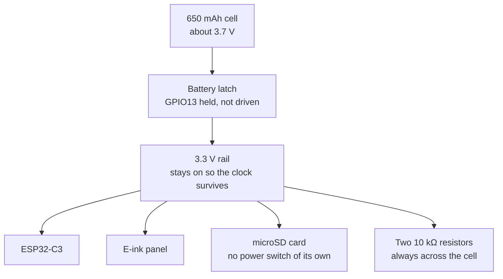
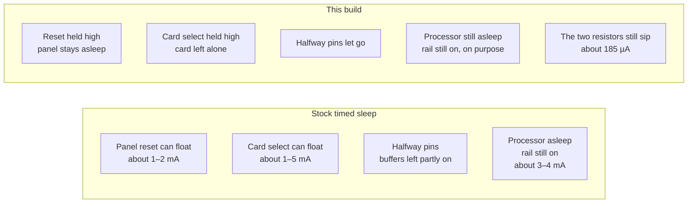
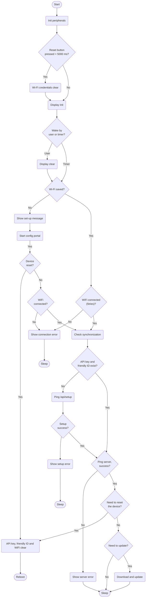

# The reader takes a real nap

This is [TRMNL firmware 1.8.17](https://github.com/usetrmnl/trmnl-firmware/releases/tag/v1.8.17) for the Xteink X4, plus one change: between hourly calendar updates, the board sleeps much more deeply. Wi-Fi, the custom server address, and the once-an-hour wake stay as they were.

The original project is GPL-3. This copy keeps that license. The nap change is in `src/x4_sleep.cpp`.

## **Power consumption**

A bit of background first, because the pretty graph in the original TRMNL notes is worth understanding before we talk about why the X4 does not get to live in it.

The ESP32-C3 is a very good little chip at being asleep. Espressif designed it so that, when your project has nothing to do, the processor can forget its working memory and drop to a few microamps. On a TRMNL OG, the practical number is higher than that theoretical floor, because the device still has to notice a button press. Keeping one GPIO awake for that button costs about 100 µA. The capture below is that nap. The line sits in a band around a hundred microamps, and the little box in the corner even adds up the charge for you.


A hundred microamps is a very small drink. Their writeup does the next step the right way: a 2500 mAh battery divided by 0.1 mA is on the order of 25,000 hours, which is years, and then they immediately remind you that a device which only sleeps is not a useful device. The second picture is the one that actually matches a day of use. The chip wakes, Wi-Fi comes up, and for several seconds the current is up in the tens or hundreds of milliamps. Then the e-paper display does its shuffle, which looks busy and costs surprisingly little. They measured one of those visits at 0.67 coulomb, which is 0.186 mAh. Almost all of it is the Wi-Fi.


That shape is the whole story of a battery calendar. There is a short, expensive minute, and a long, quiet hour. Whichever of those two you leave messy is the one that empties the cell.

The X4 has the same kind of chip, and a much less convenient board around it.

To wake on a timer, the chip has to keep its clock. On this board the clock does not have its own private supply. The battery is connected through a latch, a small MOSFET, and GPIO13 is what holds that latch shut. Hold the pin, and the whole 3.3 V rail stays up, so the clock survives and the reader can wake itself an hour later. Let the pin go, and the rail collapses. The clock dies with it. After that, only the power button or a USB cable can bring the reader back. We did not want that. The hourly calendar visit is the whole point. So GPIO13 stays held, on purpose, and the rail stays on.



Once that rail is on, everything hanging off it is invited to the party. Stock 1.8.17 put the processor into deep sleep and held GPIO13, and then stopped. The other guests were never asked to sit down.

The e-ink controller is the first of them. Its sleep is real, but only while its reset pin stays high. If reset floats, the controller treats that as a wake-up and sits there drawing about 1 to 2 mA, which is a thousand times the nap in the picture above. The firmware already tells the panel to sleep before the chip sleeps. What it did not do was keep reset from drifting afterward. This build holds reset high, and it is careful not to send the sleep command a second time. Sending it again begins with a reset pulse, which would wake the panel we just put to bed.

The microSD card is the second. It is powered straight from the rail. There is no switch to turn it off. TRMNL never mounts the card, but a card that was powered up and then left with its chip-select pin floating can sit selected and draw 1 to 5 mA for the rest of the hour. Before sleep we talk to the card in the simplest possible way, ask it to go idle if it answers, and then hold chip-select high so it is no longer invited.

The third guest is sneakier. A few pins are not high and not low. The battery-measuring pin, GPIO0, sits in the middle of two 10 kΩ resistors, so it rests near half the cell voltage. The USB-detect pin rests near a volt. A digital input that is held in the middle does not read as a clean 1 or a clean 0. Its input buffer lingers in between, and a buffer in between can burn milliamps while looking like it is doing nothing. We park those pins. The buffer goes off, the pull resistors go away, and the pin is allowed to float. The button ladders get the same treatment. GPIO13 is not in that list. Letting go of the latch would be the opposite of what we want.



Now the arithmetic, done the same way as the original notes, with the same honesty about what is a measurement and what is a sketch.

The 1.8.17 source itself describes X4 timed sleep as about 3 to 4 mA. Take the middle of that range, 3.5 mA, and pretend the reader only sleeps.

3.5 mA × 24 hours = 84 mAh per day

650 / 84 ≈ 8 days

That is the cheerful version. It is the same kind of number as the 25,000 hours in the original notes: true only if nothing else is drawing, and if the battery really gives you every milliamp-hour on the label. It is already much worse than the OG picture, because 3.5 mA is about thirty-five times 100 µA, and the cell is 650 mAh rather than 2500.

Real boards were often worse than 3.5 mA, because the panel and the card were still awake on top of that. Add a couple of milliamps for a floating reset and a couple more for a card that never got told to sit down, and 8 mA is an easy place to land.

8 mA × 24 hours = 192 mAh per day

650 / 192 ≈ 3 days

Then add the visits. This calendar wakes once an hour, which is 24 times a day. We do not have a coulomb counter capture of an X4 visit the way the original notes have 0.67 C for a TRMNL visit. The shape is the same one you can see in the picture above: Wi-Fi is the expensive part, the screen shuffle is the cheap part. A reasonable allowance for those 24 visits is about 15 to 20 mAh a day, something under 1 mAh each. Stack that on a sleepy-but-not-really-asleep rail and a full cell is gone in about two days. That matches what the reader actually felt like.

There is also a floor we cannot software our way under. The two 10 kΩ resistors that measure the battery are connected from the cell to ground whenever the latch is held. They are not switched.

3.7 V / 20,000 Ω = 0.000185 A = 185 µA

185 µA × 24 hours ≈ 4.4 mAh per day

Those two resistors, doing nothing but letting the chip glance at the battery, already drink more than the entire TRMNL OG does in its hundred-microamp nap. Hibernation on the ESP32-C3 can be a few microamps. This board cannot reach that while the timer wake holds the latch shut. A few hundred microamps, not a few, is the honest sleep current after the fix.

Call the nap 400 µA once the panel, the card, and the halfway pins are tucked in. That is a sketch, not a meter reading on this cell.

400 µA × 24 hours = 9.6 mAh per day, asleep

About 18 mAh per day for the hourly visits

9.6 + 18 ≈ 28 mAh per day

650 / 28 ≈ 23 days

Move the nap up toward 800 µA, or the visits toward the high end of that allowance, and you land nearer 16 days. So the band we actually believe is about two to three weeks. If a particular card refuses to idle and keeps a milliamp for itself, life slides back toward ten days. None of those figures replace a measurement. They are the same kind of back-of-the-envelope the original notes use before they say, correctly, that the real world comes in a little shorter.


On the next boot we let go of every pin we held, except GPIO13, and we do it before the screen's SPI bus is started. A pin that is still frozen from the nap would look exactly like a broken display. The latch stays held so the clock is not dropped on the way through the door.

The other X4 build, the one that wakes only from the power button, is untouched. That one drives GPIO13 low and shuts the rail off. It is a different product. This one is the reader that comes back by itself.

## The short version

The old sleep was a light nap. The screen and a few other parts stayed a little bit awake, like a flashlight left on very dim. A full battery lasted about two days.

This version tells those parts to sleep too.

- The screen is told to rest, and its reset pin is held so it cannot pop back awake.
- The memory card is told to sit quietly, then its select pin is held off.
- Pins that were stuck halfway on are let go, so they stop leaking power.

The reader still wakes up by itself, draws today, and naps again. A full battery should last about two to three weeks.

It cannot sleep as deeply as a watch. One small circuit has to stay on so the reader remembers when to wake. That circuit sips a little power the whole time.

Flashing this does not forget Wi-Fi if the erase box is left empty.

## How the nap works

The X4 is an ESP32-C3 with a 650 mAh cell. In stock 1.8.17 timed sleep, the chip holds GPIO13 high. That keeps a MOSFET (the battery latch) on, so the 3.3 V rail and the RTC stay powered and the timer can wake the chip. Sleep current in that state is about 3–4 mA. With an hourly Wi-Fi refresh, the cell is empty in about two days.

Cutting GPIO13 would drop the current much further, and it would also kill the RTC. Only the power button or USB could wake the board. This build does not do that. GPIO13 is held, not driven.

The extra milliamps came from parts left in an active state:

- The e-ink controller (SSD1677) draws about 1–2 mA if reset is floating, because it wakes up. Reset is held high after the panel's existing sleep command. A second sleep command is not sent: that command starts with a reset pulse and would wake the panel again.
- The microSD card has no power switch. If its chip-select floats, the card can draw 1–5 mA. The firmware never mounts the card. Before sleep it sends the card's idle commands when a card answers, then holds chip-select high.
- GPIO0 sits on a 10 kΩ + 10 kΩ battery divider, near half the cell voltage. GPIO20 sits near 1 V from USB detection. A pin in that middle range turns the input buffer partly on and can waste milliamps. Those pins, the button ladders, and other unused pins are parked: input buffer off, no pull, floating.
- The divider itself cannot be switched off. At 3.7 V across 20 kΩ it draws about 185 µA whenever the latch is on. That is the floor. ESP32-C3 hibernation is a few microamps, but this board cannot reach it while the timer wake keeps the latch closed.

So asleep, this build should sit at a few hundred microamps, not a few milliamps, and not a few microamps. On a 650 mAh cell, with the hourly Wi-Fi still costing about 15–20 mAh a day, a reasonable expectation is two to three weeks. That is an estimate, not a meter reading on this cell. A stubborn SD card can pull it back toward ten days.

On the next boot, the held pins are released before SPI starts. GPIO13 stays held so the latch does not drop. The button-only build, which drives GPIO13 low and powers the board off, is unchanged.

## Original TRMNL readme

# TRMNL Firmware

created for the [TRMNL](https://trmnl.com) e-ink display.

> [!IMPORTANT]
> the `main` branch is under constant development and may contain breaking changes. flash at your own risk.
>
> to access production-ready firmware, check out the [tagged releases](https://github.com/usetrmnl/trmnl-firmware/releases/)
 or use the [Flash Assistant](https://trmnl.com/flash).
## **Algorithm block scheme**



## **Web Server Endpoints**

following Wifi connection via the captive portal, device swaps its Mac Address for an API Key and Friendly ID from the server (which get saved on device).

```curl
GET /api/setup

headers = {
  'ID' => 'XX:XX:XX:XX:XX' # mac address
}

response example (success):
{ "status": 200, "api_key": "2r--SahjsAKCFksVcped2Q", "friendly_id": "917F0B", "image_url": "https://trmnl.com/images/setup/setup-logo.bmp", "filename": "empty_state" }

response example (fail, device with this Mac Address not found)
{ "status" => 404, "api_key" => nil, "friendly_id" => nil, "image_url" => nil, "filename" => nil }
```

assuming the Setup endpoint responded successfully, future requests are made solely for image / display content:

```curl
GET /api/display

headers = {
  'ID' => 'XX:XX:XX:XX',
  'Access-Token' => '2r--SahjsAKCFksVcped2Q',
  'Refresh-Rate' => '1800',
  'Battery-Voltage' => '4.1',
  'FW-Version' => '2.1.3',
  'RSSI' => '-69'
}

response example (success, device found with this access token):
{
  "status"=>0, # will be 202 if no user_id is attached to device
  "image_url"=>"https://trmnl.s3.us-east-2.amazonaws.com/path-to-img.bmp",
  "filename"=>"2024-09-20T00:00:00",
  "update_firmware"=>false,
  "firmware_url"=>nil,
  "refresh_rate"=>"1800",
  "reset_firmware"=>false
}

response example (success, device found AND needs soft reset):
{
 "status"=>0,
 "image_url"=>"https://trmnl.s3.us-east-2.amazonaws.com/path-to-img.bmp",
 "filename"=>"name-of-img.bmp",
 "update_firmware"=>false,
 "firmware_url"=>nil,
 "refresh_rate"=>"1800",
 "reset_firmware"=>true
}

response example (success, device found AND needs firmware update):
{
 "status"=>0,
 "image_url"=>"https://trmnl.s3.us-east-2.amazonaws.com/path-to-img.bmp",
 "filename"=>"name-of-img.bmp",
 "update_firmware"=>true,
 "firmware_url"=>"https://trmnl.s3.us-east-2.amazonaws.com/path-to-firmware.bin",
 "refresh_rate"=>"1800",
 "reset_firmware"=>false
}

response example (fail, device not found for this access token):
{"status"=>500, "error"=>"Device not found"}

if 'FW-Version' header != web server `Setting.firmware_download_url`, server will include absolute URL from which to download firmware.
```

if device detects an issue with response data from the `api/display` endpoint, logs are sent to server.

```curl
POST /api/log

# example request tbd
```

## **Power consumption**

A bit of background first. The ESP32-C3 inside the TRMNL OG is one of Espressif's newer, more efficient microcontrollers. For battery powered applications, it's designed to be put to sleep to conserve power when your project doesn't need it to be active. There are two sleep modes - light and deep. Deep sleep conserves the most power, but at the cost of losing the contents of the main memory. The lowest possible power consumption is about 4uA @ 3V with a timed wakeup, but TRMNL needs to be able to wake up with a button press. Keeping the GPIO active during deep sleep (to detect the button press) uses about 100uA on average (see power profile below). This means that a 2500mAh battery could theoretically keep the TRMNL powered in this state for approximately 25,000 hours.


Of course its not very useful to have a device that's permanently sleeping, so shown below is the power profile of TRMNL doing a normal display update (timed wake up, send device status, fetch new image, show it on the e-paper display):


The peaks and valleys you see above represent the variation in electrical current (power) drawn by the ESP32-C3 at different points during the ~10.5 second update cycle. The majority of energy is used while WiFi is active (between the 3 and 9 second marks). The last portion of the graph with higher frequency peaks is from the e-paper display cycling through its update (average power is quite low). The total electrical charge needed for the update is shown in the lower right corner (0.67c). This value is in Coulombs and represents the number of electrons that have moved through the circuit.

0.67 C = 0.186111 mAh

If we ignore the ESP32 sleep periods, the energy used in each display update would allow 2500/0.186111 = 13433 updates. If we configure our TRMNL account to update the information every 15 minutes, we'll be requesting 96 updates per day and the battery charge could last for 140 days (13433 / 96). This isn't too far off from real world results. The battery voltage will drop below a safe threshold before it has released its full energy and in the equation above, we haven't counted the energy used during the sleep periods nor the energy lost in the TRMNL's power supply (between the battery and the ESP32). The real world result will be closer to 120 days on a full charge.

We can extend the battery life further by disabling updates during our sleeping hours. In the TRMNL web portal there is a setting for “Sleep Mode” (see screenshot below):


For example - by reducing the total active time each day by 8 hours, the number of updates per day (set to a 15-minute interval like above) changes from 96 to 64. With sleep mode set to 8 hours, our battery life is extended:

13433 / 64 = 210 days (theoretical maximum)

**Designed for Efficiency**

Lithium batteries deliver between 3.7 and 4.2 volts depending on their charge state. The ESP32 operates between 2.8V and 3.3V. In order to power the ESP32 from the battery, the voltage needs to be reduced.

There are two main types of power regulators - [buck](https://en.wikipedia.org/wiki/Buck_converter) converters, and [linear](https://en.wikipedia.org/wiki/Linear_regulator) regulators. Many ESP32 products use linear regulators since they are less expensive. This savings comes at a cost - they throw away up to 20% of the battery's energy as waste heat. Your TRMNL was designed with a buck converter to safely and efficiently power the ESP32. This ensures the best use of the battery's energy. At TRMNL we are always looking for additional software optimizations that improve battery life.

## **Low Battery Level**

Lithium ion batteries are ubiquitous in our lives; they're in nearly everyone's pocket/purse and many other devices you use daily. They bring a host of benefits, some risks and require care to keep them working at their best. Your TRMNL protects the battery against overcharging, but your help is needed to prevent problems when the battery is low. There are two main problems that arise with dead Li-Ion batteries:

1. If they pass below a certain voltage, they need to be recharged with a special trickle charger; the charging circuit of the TRMNL won't be able to charge them.
2. Batteries that are left uncharged for an extended period of time can “outgas”. This means that the electrolyte goes through a chemical reaction and releases hydrogen gas. You may have seen batteries in this state - the metal envelope puffs up like a balloon.

The conditions above are to be avoided, but `#2` can be dangerous as well. If your battery is puffy, dispose of it safely at a local recycling spot and contact TRMNL support to get a new one.

Even when your TRMNL is disconnected (power switch in the off position), its battery will slowly self-discharge. To keep your TRMNL's battery running at peak performance:
1. Charge your device immediately when the low battery image is shown.
2. If you've switched off your TRMNL for storage/moving, ensure the battery is not already low.

## **Version Log**

See [releases](https://github.com/usetrmnl/firmware/releases). For older versions go [here](https://github.com/usetrmnl/firmware/issues/95).

## **Compilation guide**

There are technical and non-technical options to flashing firmware.

### **No code required**

* Flash directly from a web browser: https://trmnl.com/flash
* Enable OTA updates from your TRMNL dashboard > Device settings (native hardware only)


### **Via CLI**
1. To build the binary run `pio run -e TRMNL_X_dev`
2. To upload the binary to the device `pio run -e TRMNL_X_dev -t upload`
3. If PlatformIO uses the wrong port use this
```bash
pio device list # make sure JTAG device is visible
pio run -e TRMNL_X_dev -t upload --upload-port /dev/cu.usbmodem1234
```
4. view serial monitor by
```bash
pio device monitor -e TRMNL_X_dev
pio device monitor -e trmnl
```

When switching between TRMNL X and OG/BWRY, run `pio pkg install` once for the environment you are about to build (use the same `-e` value as `pio run`):

```bash
pio pkg install -e TRMNL_X_dev   # TRMNL X
pio pkg install -e trmnl         # TRMNL OG
pio pkg install -e trmnl_4clr    # TRMNL BWRY
```

If you skip this step, the build may fail with `Error: Missing Arduino framework directory 'None'`.


### **Using VSCode plugin**

1. Install VS Code: https://code.visualstudio.com
2. Install PlatformIO: https://platformio.org/install/ide?install=vscode
3. Install Git: https://git-scm.com/book/en/v2/Appendix-A%3A-Git-in-Other-Environments-Git-in-Visual-Studio-Code
4. Clone this repository: https://github.com/usetrmnl/trmnl-firmware
5. Open project in VS Code workspace
6. After configuring the project, click the PlatformIO -> Build button located at the bottom of the screen


7. After the compilation process is complete, you should expect to see a message in the console.


8. You can find the compiled file in the folder shown in the picture.


## **Uploading guide (PlatformIO)**

1. Put the TRMNL into flashing mode.

    1. **TRMNL OG and BWRY**: Turn off PCB. Connect PCB to PC using USB-C cable. While holding down the boot button, turn on PCB. Let go of boot button. This puts board in flashing mode.
    2. **TRMNL X**: [See these instructions](https://help.trmnl.com/en/articles/11936721-put-your-trmnl-in-flashing-mode#h_96e07a072e)

2. Mac/Windows: Select the proper COM port from drop-down list (or leave on "Auto"). Ubuntu: Look for something like "/dev/ttyACMO USB JTAG/serial debug unit" or "Espressif USB JTAG/serial debug unit" via lsusb.


3. Click on "PlatformIO: Upload" button.

## **Uploading guide (ESP32 Flash Download Tool)**

Tools required:

1. Windows OS
2. Flash Tool 3.9.5
3. Binaries to merge - `bootloader.bin`, `firmware.bin`, `partitions.bin` (see Compilation Guide above)
4. Bootloader binary file (`boot_app0.bin`, found in ~/.platformio/packages/framework-arduinoespressif32/tools/partitions/)

### Step 1 - Configure flash tool
open the Flash Tool (executable file), select these parameters, then click OK:


### Step 2 - Add binaries
1. Beside the top blank space, click “...” dots and select the bootloader binary file then input
> “0x00000000”
in the far right space and check the box.

2. Click “...” dots and select the partitions binary file then input
> “0x00008000”
in the far right space and check the box.

3. Click “...” dots and select the boot_app0 binary file then input
> “0x0000e000”
in the far right space and check the box.

4. Click “...” dots and select the firmware binary file then input
> “0x00010000”
in the far right space and check the box.


finally, set the following parameters at the bottom of the Flash Tool interface:


### Step 3 - Connect and flash device
1. Open the Windows “Device Manager” program and scroll to the bottom where the USB devices can be found. each machine will have different available devices, but look for a section like this:


2. Next, connect the PCB to the Windows machine with a USB-C cable. make sure the USB port is on the right, and that the PCB’s on/off switch is toggled DOWN for “off.”

3. While holding the BOOT button (below the on/off toggle), toggle the device ON by flipping the above switch UP. you may hear a sound from your Windows machine Inspect the Device Manager connections at the bottom of the interface, and a new device should appear. it may be “USB Component {{ Num }},” or something like below:


4. Take note of this device’s name, that is our TRMNL PCB. then back inside the Flash Tool, click to open the “COM” dropdown in the bottom right and choose the TRMNL PCB. finally, click the “START” button.


### Step 4 - Prepare for new device flashing
Inside the Flash Tool click the “STOP” button.


Next turn off (toggle DOWN) and unplug the PCB. you are now ready to flash another device - see Step 1.

## **Hacking guide**

### Local unit tests

If you would like to run local tests, you'll need to have g++/gcc installed (f.e., as part of MinGW) in PATH:

- Get MinGW online installer from https://github.com/niXman/mingw-builds-binaries/
- Add path to `bin` from installed folder (f.e. `c:\mingw64\bin`) to your PATH
- Restart Visual Studio Code

Now you can switch from "env:esp32..." to "esp:native" clicking at the bottom of the studio (point 1):


And then run platformio tests by clicking test button (point 2).

### Hardware integration tests

There is a suite of on-device hardware tests written with the [Unity](https://registry.platformio.org/libraries/throwtheswitch/Unity) test framework, defined in `test/integration/test_all`. They compile into a single firmware image that is uploaded to the device, runs the tests sequentially in `setup()`, and prints results over the serial port.

To run the test suite (currently only on OG):

1. Make a copy of `test/integration/test_config.h.example` to `test/integration/test_config.h` and modify the file as needed to set up the WiFi network and other values. This file is ignored by Git and will not be checked in.
2. Select the `env:trmnl_test` environment.
3. Plug in the device and run the "PlatformIO: Test" action.
    1. If the upload fails, retry the Test action once.
    2. If the upload still fails, ensure the device is on.
    3. If the upload still fails, put the device into flashing mode - see "Uploading guide (PlatformIO)" above, and retry.


You should see terminal output like:

```
test/integration/test_all/all.test.cpp:33: connect_to_wifi      [PASSED]
test/integration/test_all/all.test.cpp:75: test_setup_succeeds_with_registered_mac      [PASSED]
test/integration/test_all/all.test.cpp:76: test_setup_returns_status_error_for_unknown_mac      [PASSED]
test/integration/test_all/all.test.cpp:77: test_setup_fails_with_unreachable_host       [PASSED]
test/integration/test_all/all.test.cpp:97: test_low_battery_returns_low_battery_image   [PASSED]
test/integration/test_all/all.test.cpp:63: test_wifi_connects_with_valid_credentials    [PASSED]
test/integration/test_all/all.test.cpp:64: test_wifi_fails_with_wrong_password  [PASSED]
test/integration/test_all/all.test.cpp:65: test_wifi_fails_with_wrong_ssid      [PASSED]
---------------------------------------------------------------------------- trmnl_test:integration/test_all [PASSED] Took 56.49 seconds ----------------------------------------------------------------------------

====================================================================================================== SUMMARY ======================================================================================================
Environment    Test                  Status    Duration
-------------  --------------------  --------  ------------
trmnl_test     integration/test_all  PASSED    00:00:56.488
```

## Code Formatting

We use `clang-format` for formatting C/C++ source files. You can install it [via Homebrew](https://formulae.brew.sh/formula/clang-format) or your package manager of choice - it's part of `llvm`.

Two ways to format files:

1. Run `./scripts/format.sh` to format the entire repository.
2. VS Code users: install [the C/C++ extension](https://marketplace.visualstudio.com/items?itemName=ms-vscode.cpptools) which will automatically format-on-save using clang-format.